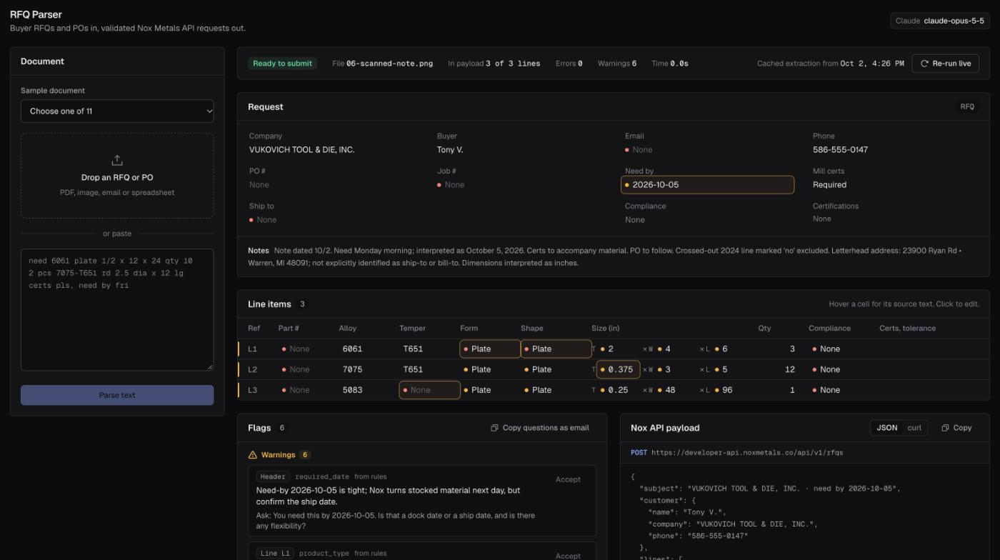

# RFQ Parser for Nox Metals

Turns a buyer's RFQ or PO, in whatever form it arrives, into a validated request for the Nox Metals RFQ API (`POST /api/v1/rfqs`).

Buyers send emails, SAP-style PDF purchase orders, BOM spreadsheets, scanned pages and phone photos of handwritten notes. RFQ Parser extracts every line item, checks it against Nox's catalog and API rules, and shows a reviewer what needs a decision. Missing, ambiguous or out-of-stock items become flags with a ready-to-send question for the buyer. Nothing is filled in, rounded or dropped silently.



## Features

- **Any input format.** PDF (including scans with no text layer), PNG/JPG photos, XLSX/CSV, `.eml` threads and pasted text.
- **Traceable values.** Every extracted field keeps the verbatim text it came from and a confidence level. Hover a cell to see its source.
- **Catalog-aware validation.** Checks alloy, temper and form against Nox's catalog, flags plate thicknesses Nox doesn't stock, enforces the API's 1–200 quantity limit, and catches tight need-by dates.
- **Spec callouts.** Resolves AMS, QQ and ASTM callouts (for example AMS 4027 or QQ-A-250/12), DFARS clauses and mill-cert requirements.
- **Editable review.** Correct any cell or accept a warning, and the flags and payload recompute instantly. Lines with blocking errors are held out of the payload.
- **Buyer follow-up.** **Copy questions as email** turns open flags into a reply to the buyer.
- **Safe submission.** Requests carry an idempotency key derived from the body, so retries never create duplicate RFQs. After submitting, the app follows the RFQ until Nox has priced it.

## Compared with Upload PO on noxmetals.co

The **Upload PO** feature on [noxmetals.co/quote](https://noxmetals.co/quote) reads scanned and handwritten documents well. It's designed for a buyer getting an instant quote, so it fits each request to what the quote form can price. RFQ Parser is designed for the person reviewing the request, so it keeps everything the buyer asked for.

The same two image-only PDFs were run through both on 2026-10-15:

| Buyer asked for | Upload PO | RFQ Parser |
|---|---|---|
| 7075-T651 **.375** × 3 × 5 (handwritten) | Quoted at **0.5"** thick, with no notice | Keeps 0.375" and flags it as a non-stock thickness (nearest 0.25" or 0.5") |
| 5083 1/4 × 48 × 96 (handwritten) | Line dropped | Kept, with a question: H116 or H321? |
| 2024-T351 1.25 × 10 × 20 (scanned PO) | Line dropped | Kept and checked against the catalog. If it isn't stocked, it's routed to sales |
| Need-by 10/05, "EXPEDITE" | Standard ship date shown | Flagged as a tight date |
| Crossed-out line | Skipped | Skipped |
| Photos, XLSX, email threads | Not accepted | Accepted |

## Getting started

Requires Node.js 20 or later.

```bash
npm install
cp .env.example .env.local
npm run dev
```

Open http://127.0.0.1:3000 and pick a sample document. The bundled samples have cached extractions, so they open instantly without any keys. To parse new documents, add an AI provider key to `.env.local`.

| Variable | Purpose |
|---|---|
| `ANTHROPIC_API_KEY` | Extraction with Claude (`claude-opus-5-5`) |
| `OPENAI_API_KEY` | Extraction with the OpenAI Responses API (model set by `OPENAI_MODEL`) |
| `LLM_PROVIDER` | `claude`, `openai` or `chatgpt`, when more than one is configured |
| `NOX_API_KEY` | Uses Nox's live materials catalog and submits RFQs to Nox |
| `NOX_API_BASE_URL` | Defaults to `https://developer-api.noxmetals.co` |
| `MOCK_LLM` | Set to `1` to return a fixed extraction, for running the app with no provider |

Extraction can also run on a ChatGPT plan instead of an API key; see [docs/chatgpt-sign-in.md](docs/chatgpt-sign-in.md).

### Submitting to Nox

With `NOX_API_KEY` set, **Submit to Nox** sends the RFQ after a confirmation and shows its pricing status. Without a key, the button reads **Create RFQ** and nothing is sent: the panel shows the exact request, as JSON or `curl`, that would have gone to Nox.

## How it works

```
document ─► extract ─► normalize ─► validate ─► build payload ─► submit
```

| Stage | Code | What happens |
|---|---|---|
| Extract | `lib/extract.ts`, `lib/extract-openai.ts`, `lib/prompt.ts` | The model returns a schema-typed RFQ (Zod). Each field has a value, a confidence and a source quote. PDFs and images go to the model directly; spreadsheets are converted to text. |
| Normalize | `lib/normalize.ts`, `lib/units.ts`, `lib/specs.ts` | Fractions, millimetres, glued tempers such as `AL6061T651` and spec callouts become catalog terms. |
| Validate | `lib/validate.ts`, `lib/materials.ts` | Deterministic rules check the catalog and API limits. Rule flags take precedence over model flags. |
| Build payload | `lib/payload.ts`, `lib/analyze.ts` | Produces the `CreateRfqDto`. PO number, part number, tolerance, need-by date and cert requirements go into each line's `job_detail`, since the API has no fields for them. |
| Submit | `lib/nox.ts`, `lib/request.ts` | Sends to Nox, or returns the request when no key is set. |

Extractions are cached by a hash of the document (`lib/extraction-cache.ts`), because a model run takes one to two minutes. Validation always re-runs, so date checks and catalog changes stay current. **Re-run live** bypasses the cache.

## Project structure

```
app/              Next.js pages and API routes (parse, submit, samples, status)
components/       Review UI: request header, line table, flags, payload
hooks/            Editor state and RFQ status polling
lib/              Extraction, normalization, validation, payload and Nox client
data/             Seed catalog and stock plate thicknesses
samples/          Sample documents, ground truth and cached extractions
scripts/eval.ts   Accuracy evaluation over the samples
tests/            Unit tests
docs/             Nox OpenAPI spec and ChatGPT sign-in guide
```

## Testing

```bash
npm test            # unit tests, no credentials needed
npm run typecheck
npm run eval        # field accuracy and flag recall against samples/expected (needs an AI key)
```

[samples/README.md](samples/README.md) describes each sample document and what it exercises.

## Notes

- Without `NOX_API_KEY`, the catalog is an approximation built from public noxmetals.co pages (`data/materials.seed.json`).
- Stock plate thicknesses for 6061, 7075 and 7050 (`data/plate-thicknesses.json`) come from the noxmetals.co instant-quote form. The materials API doesn't expose thicknesses, so the list needs updating when stock changes.
- The payload follows Nox's published API spec in `docs/nox-openapi.json`.
- All companies, people and part numbers in the samples are fictional.
